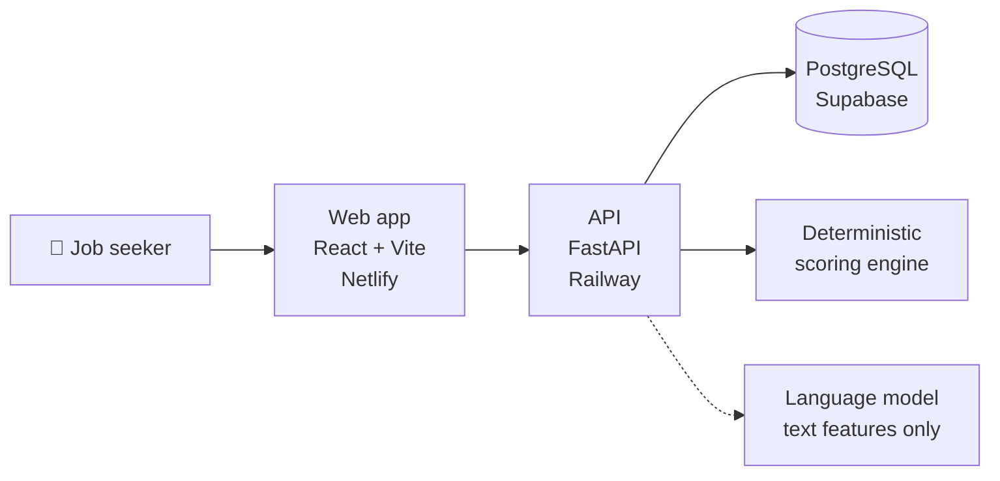

# ClearScan Engineering

**Field notes from building and running a production ATS resume scanner**

[Website](https://clearscan.fyi) · [Start here](#-start-here) · [Incidents](#-incidents) · [Build your own](build-your-own/README.md) · [LinkedIn](https://www.linkedin.com/company/clearscan-ats/)

---

## 👋 What this is

[ClearScan](https://clearscan.fyi) is a free tool that scores a resume
against a specific job posting and shows every rule behind the number. It is
operated by one person.

This repository is **not** its source code. It is a write-up of how the system
is built, what broke in production, and what those failures taught. The
scoring engine is private. The reasoning behind it is not, and most of what is
hard about this problem has nothing to do with the constants.

> If you are building your own ATS or resume scanner, this is meant to save
> you some of the mistakes.

## 🧭 Start here

| Read | You will learn |
|---|---|
| [The problem](docs/01-the-problem.md) | Why scoring a resume is harder than matching keywords |
| [Architecture](docs/02-architecture.md) | How the system fits together, and what each boundary costs |
| [Scoring philosophy](docs/03-scoring-philosophy.md) | How to reason about a score when there is no ground truth |
| [Anti-gaming](docs/04-anti-gaming.md) | Handling resumes written for the scanner rather than the job |
| [AI that doesn't invent facts](docs/05-ai-that-doesnt-invent.md) | Five layers, and why the most important one is not AI |

## 🔥 Incidents

The parts worth reading. Real production failures: what it looked like, how it
was found, and the general lesson.

| Incident | The lesson in one line |
|---|---|
| [The disabled webhook](incidents/01-the-disabled-webhook.md) | Six bugs fixed, and the cause was none of them |
| [The empty list](incidents/02-the-empty-list.md) | One return value that meant two things deleted user data |
| [Green tests, broken production](incidents/03-green-tests-broken-production.md) | A mock that did not behave like the real object |
| [Throwing away the AI verifier](incidents/04-throwing-away-the-ai-verifier.md) | Measuring your own clever idea, then deleting it |
| [The tests that tested a copy](incidents/05-the-tests-that-tested-a-copy.md) | A green suite that never touched the code users run |

## 🏗️ The system at a glance

The core score is **deterministic and rule-based**: the same resume and posting
always produce the same number, because a score you cannot reproduce is not a
measurement. No language model is called to produce it. Two features use a
model, both for generating text rather than judging, and both are checked
against the user's actual resume.

ClearScan charged for a subscription until 31 October 2026 and has been free
for every registered user since.

## 🧱 Principles

| Principle | In practice |
|---|---|
| **Reproducible** | Same inputs, same score, every time |
| **Explainable** | The user sees the reasoning, so they can disagree with a finding |
| **Limits, not accusations** | Suspicious patterns cap a score. They never label a person |
| **Facts come from the user** | Generated text is checked against the resume |
| **Honest about limits** | The tool says what it cannot know |

## 📚 Reference

- [Technology choices](docs/06-technology-choices.md)
- [Testing and CI](docs/07-testing-and-ci.md)
- [Security and privacy](docs/08-security-and-privacy.md)
- [Engineering decisions](docs/09-engineering-decisions.md)
- [Payment architecture (historical)](docs/10-payment-architecture.md)
- [Build your own](build-your-own/README.md)
- [Current figures](STATUS.md) and [Changelog](CHANGELOG.md)

Numbers that change over time live only in [STATUS.md](STATUS.md), so the rest
of these pages stay true.

## 🔒 What this repository is not

Not the ClearScan source code, which is private. Not open source software.

## 📄 License

The writing in this repository is licensed under
[CC BY 4.0](LICENSE): reuse and build on it freely, with credit. The license
covers these documents only, not the ClearScan software, name or logo.

## 👤 Author

Swagat Subhash Kalita designs, builds and operates ClearScan.

[clearscan.fyi](https://clearscan.fyi) · [LinkedIn](https://www.linkedin.com/company/clearscan-ats/)
