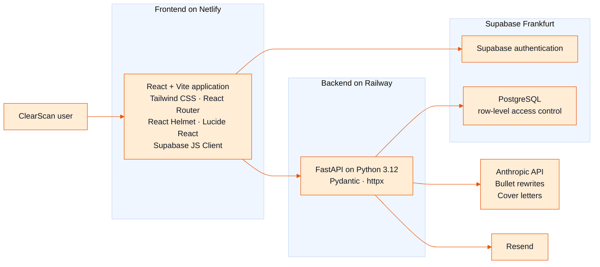

# Architecture

*The three-box view, and what separating them costs.*

## The shape

A browser app, an API, and a managed database with authentication. A few
third-party services sit around them, each doing one job.

## What lives where

- **Browser app.** Presentation, routing, the job tracker's local storage, and
  in-browser PDF generation for the resume builder.
- **API.** Everything that needs a secret or a rule: scoring, the two text
  features and email.
- **Database and authentication.** PostgreSQL with row-level access control,
  hosted in an EU region. The browser talks to authentication directly. Data
  access goes through the API.
- **Third parties.** A language model provider for two text features, and an
  email provider.

## Where the trust boundaries are

- The browser holds only public keys. Every secret lives on the API.
- The API never trusts the browser's word about anything it must verify, such
  as a payment. It asks the source. See
  [The disabled webhook](../incidents/01-the-disabled-webhook.md).
- Maintenance runs as scheduled jobs from the CI system calling protected
  internal endpoints, plus a weekly check against production.

## A scan, end to end

The user submits a resume and a job posting. The API parses the document,
runs the deterministic scoring engine, and returns the result. No language
model is involved. For a signed-in user the result is also saved to their
history.

## What this shape costs

- **Two deployments must agree.** The browser enforces a security policy that
  lists every origin the page may contact. Adding any new third-party call,
  even a public star counter, fails in production until that policy is
  updated, and the failure is easy to miss.
- **There is no staging environment.** A merge to the main branch reaches
  users. Automated tests and a weekly production check stand in for staging.
- **The API grew by accretion.** One endpoint module reached thousands of
  lines. That is how the scoring formula ended up duplicated in three places.
  See [The tests that tested a copy](../incidents/05-the-tests-that-tested-a-copy.md).
- **The database is reached over plain HTTP** through a small in-house helper
  layer. That kept dependencies light, and it is also where an outage was once
  reported as an empty result. See
  [The empty list](../incidents/02-the-empty-list.md).
- **One vendor for database and authentication** is convenient and couples
  the two. Moving one means moving both.
- **EU hosting is a deliberate choice.** Users far from Frankfurt pay for the
  distance.

## Deployment

The frontend is built and served by Netlify. The backend is built from a
Dockerfile on Railway. Both deploy automatically from the main branch. GitHub
Actions runs the automated tests first. See [Testing and CI](07-testing-and-ci.md).
