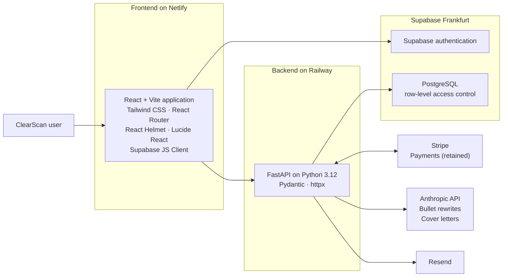

# Architecture

*Verified system boundaries for ClearScan: frontend, API, data and retained payment wiring.*

This diagram intentionally stays at the verified system-boundary level. It does not represent undocumented private modules or internal service boundaries.

## Verified deployment boundaries

- The React and Vite frontend is hosted on Netlify.
- The FastAPI backend is hosted on Railway.
- PostgreSQL and authentication use Supabase, with the database in the Frankfurt region.
- Row-level access control is enabled in Supabase/PostgreSQL.
- Payments were handled by Stripe; no card data is stored. Payment charging is disabled by a feature flag and the code is retained. See [Payment architecture (historical)](10-payment-architecture.md).
- Anthropic API calls are limited to bullet rewrite suggestions and cover-letter generation. Until 31 October 2026 those features sat behind the paid tier; the product has been free for every registered user since.
- GitHub Actions runs the automated tests. Production deploys automatically from the main branch: the frontend on Netlify and the backend on Railway, built from a Dockerfile.
