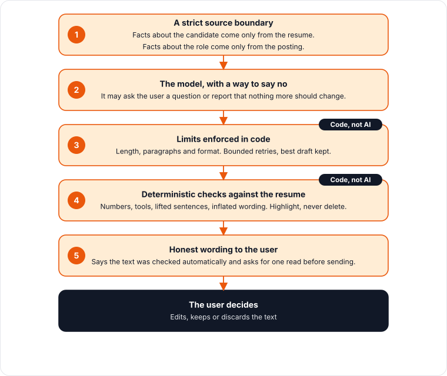

# AI that doesn't invent facts

*Layers that stop a language model from putting claims in your mouth, and why
the most important layer is not AI.*

ClearScan uses a language model for two features: rewrite suggestions and
cover letters. Both write text on behalf of a job applicant, which makes
invention a serious failure. A fabricated tool or an inflated title can end
up in front of a hiring manager under the applicant's name.

The core score never calls a model. This page covers only the text features.

## The layers

**1. A strict source boundary.** The resume is the only source of facts about
the candidate. The job posting is the only source of facts about the role.
A requirement in the posting is never treated as something the candidate has
done. Most invention starts when those two sources blur together.

**2. A way to say no.** A model told to always produce text will produce text.
So the output format includes honest exits: ask the user a question when the
resume does not support a claim, or report that the posting forbids AI-written
applications. Rewrite suggestions have a "nothing more to change" outcome
instead of forcing a weak fifth suggestion. A system that is allowed to say
"I need more from you" invents less.

**3. Limits enforced in code.** Length, paragraph count and format are checked
by ordinary code, not trusted to the model. If a draft breaks them, the system
retries a bounded number of times, keeps the best draft seen, and never
returns an answer that was cut off mid-sentence.

**4. Deterministic checks after generation.** Plain code compares the output
with the resume. It looks for numbers that are not in the resume, tools that
are not in the resume, sentences lifted from the posting, inflated wording,
and claims about feelings or motivation. Flagged sentences are highlighted
for the user. They are never silently deleted.

**5. Honest wording to the user.** The interface says the text was checked
automatically and asks the reader to read it once before sending. It does not
claim certainty it does not have.

## Why layer 4 is not a model

An obvious design is a second model that verifies the first. It was built and
measured, and it was removed from the path: it was slow, missed a large share
of known problems, and produced a false sense of safety. The full story is in
[Throwing away the AI verifier](../incidents/04-throwing-away-the-ai-verifier.md).
Deterministic checks are fast, cheap and predictable, and their failures can
be read and fixed.

## Four bugs found by reading, not counting

The checks themselves had defects, and every one was found by reading the
generated text rather than by counting flags.

- **Equivalent numbers.** A resume said "10K+" and the letter said "10,000".
  The check treated them as different and flagged a true statement as
  unsupported. Numbers must be normalised before comparison.
- **Honest gaps flagged as claims.** The sentence admitting the candidate has
  not used a tool was flagged for mentioning the tool. The system was
  punishing the exact honesty it asks the model to produce.
- **A failed retry returned the bad draft.** The format retry ran, failed, and
  the malformed letter was returned anyway. The loop now keeps the best draft
  and gives up loudly.
- **Overlapping phrases produced duplicate highlights.** One sentence with two
  real problems showed three flags. Overlaps are now suppressed so one
  problem gives one highlight. This has a known cost: a second, rarer
  occurrence of a shorter phrase in a different sentence is now reported only
  once.

A flag count would have scored the best configuration as perfect. Reading the
letters showed otherwise.

## Operational lessons

- **Reasoning mode was not worth its cost.** On a four-job comparison across
  three fields, letting the model "think" before writing made generation take
  about ten times as long, around seventy seconds against seven on average,
  and cost several times more. Quality was a draw, and two of the strongest
  letters came from the cheaper setting. It was turned off.
- **Evaluate the configuration you run.** Earlier tuning had been measured
  with evaluation defaults that differed from production, which made those
  judgements unreliable. The evaluation script now follows the production
  baseline, and a test fails if the committed baseline changes unnoticed.
- **Keep test inputs private.** Evaluation uses a real resume, so those
  fixtures stay out of version control.

## What is still unproven

The checks have no measured false-positive rate. Measuring one would need a
labelled set of honest and fabricated letters, and that set does not exist
yet. Until it does, the highlights are a prompt for the reader's attention,
not a verdict.

## For your own system

Put the facts in the input and say they are the only source. Give the model
a way to ask instead of invent. Enforce structure in code. Check output with
cheap deterministic rules before you reach for another model. Show the user
what was flagged, and say plainly how much to trust the result.
