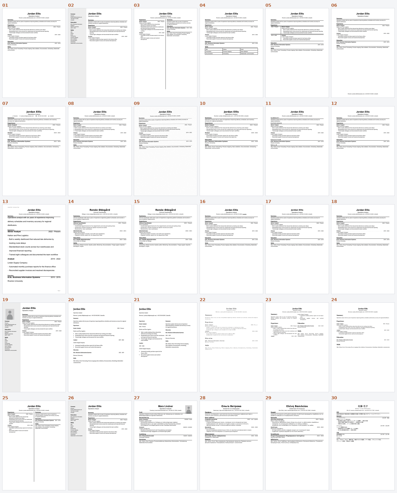

# Synthetic resumes

*30 invented resumes, each built around one thing that makes text
extraction hard, with ground truth and a first benchmark.*



## Why this exists

Nobody outside a vendor can say how well resume parsers read real files,
because there is no public set to test on and real resumes cannot be
published. This set fills that gap with invented content. Every file carries
a ground-truth list of the words a person reads, in reading order, so any
extractor can be scored the same way.

The first results are in [RESULTS.md](RESULTS.md). Read the limits section
before quoting a number.

## Everything is invented

The people, employers, schools, phone numbers and addresses do not exist.
Email addresses use the reserved `example.com` domain and phone numbers use
placeholder digits. Any resemblance to a real person is accidental.

## Licences

The data is CC0 1.0 ([LICENSE-DATA](../LICENSE-DATA)). The code is MIT
([LICENSE-CODE](../LICENSE-CODE)).

## What is in the folder

| Path | Contents |
|---|---|
| `resumes/` | The PDFs, plus `overview.png` |
| `truth/` | One JSON file per resume: reading-order text, contact strings to check, link targets |
| `manifest.json` | Index of the set |
| `generator/` | Python that builds the reportlab, word-processor and LaTeX files |
| `benchmark/` | The runner, the report writer, pinned requirements and the raw results |
| `RESULTS.md` | The first benchmark, generated from the raw results |

## The resumes

| File | Trap | Producer | Pages |
|---|---|---|---|
| `01-baseline-single-column` | Control: a plain one-column resume. | reportlab | 1 |
| `02-sidebar-two-column` | Reading order across a shaded sidebar and a main column. | reportlab | 1 |
| `03-two-equal-columns` | Reading order across two text columns of the same width. | reportlab | 1 |
| `04-skills-grid-table` | Short items laid out in table cells. | reportlab | 1 |
| `05-experience-date-column` | Table where dates sit beside the description. | reportlab | 1 |
| `06-contact-in-footer` | Contact details placed away from the top of the page. | reportlab | 1 |
| `07-icon-glyphs-contact` | Symbol characters used as icons. | reportlab | 1 |
| `08-symbol-bullets` | Non-standard bullet characters. | reportlab | 1 |
| `09-scanned-image-only` | A page that is only a picture of text. | reportlab (raster) | 1 |
| `10-ligature-glyphs` | Letters such as fi and fl stored as single ligature characters. | reportlab | 1 |
| `11-letter-spaced-headings` | Headings drawn with wide character spacing. | reportlab | 1 |
| `12-drawing-order-reversed` | Sections written to the file bottom-up; the page looks normal. | reportlab | 1 |
| `13-repeated-page-furniture` | Text that repeats on every page and is not content. | reportlab | 2 |
| `14-decomposed-accents` | Letters stored as a base letter plus a combining mark. | reportlab | 1 |
| `15-composed-accents` | Control for 14: the same text with single-character accents. | reportlab | 1 |
| `16-link-label-only` | The address lives in a link annotation, not in the page text. | reportlab | 1 |
| `17-name-as-image` | A name that exists only as pixels. | reportlab | 1 |
| `18-dot-leader-dates` | Rows of dots used as a visual tab. | reportlab | 1 |
| `19-photo-and-sidebar` | A picture at the top of a two-column layout. | reportlab | 1 |
| `20-docx-baseline` | Control from a different producer. | python-docx + LibreOffice | 1 |
| `21-docx-table-two-column` | Two columns made with a borderless table. | python-docx + LibreOffice | 1 |
| `22-latex-single-column` | Bitmap Type 3 fonts with no text mapping: ligature letters are lost (depends on the TeX Live installation). | pdflatex | 1 |
| `23-latex-two-column` | Running text that wraps from one column to the next (Type 1 font, Unicode map). | pdflatex | 1 |
| `24-latex-single-column-unicode-map` | Control for 22: the same text with an embedded Type 1 font and a Unicode map. | pdflatex | 1 |
| `25-two-columns-written-row-by-row` | Text written to the file line by line across both columns. | reportlab | 1 |
| `26-sidebar-written-row-by-row` | Text written to the file line by line across sidebar and main column. | reportlab | 1 |
| `27-german-cv-with-photo` | Second-language headings, umlauts, month/year dates and a portrait. | reportlab | 1 |
| `28-cyrillic-text` | A resume written entirely in Russian. | reportlab | 1 |
| `29-greek-text` | A resume written entirely in Greek. | reportlab | 1 |
| `30-japanese-cid-font` | Japanese text in an unembedded CID font, with no spaces between words. | reportlab | 1 |

Resumes `14` and `15` use a second invented person with accented characters.
Resumes `27` to `30` are written in German, Russian, Greek and Japanese.
Resume `09` is a picture of text with no text layer.

## Use it

Score your own reader against the ground truth:

```python
import json
truth = json.load(open("truth/01-baseline-single-column.json"))
print(truth["reading_order"])   # lines in the order a person reads them
```

Run the benchmark, which needs Tesseract and poppler installed:

```text
pip install -r benchmark/requirements.txt
python benchmark/run_benchmark.py
python benchmark/make_report.py
```

Rebuild the PDFs. LibreOffice and a LaTeX installation are needed only for
resumes `20` to `24`. The committed PDFs are the reference, because the
word-processor and LaTeX files depend on the tools that built them.

```text
python generator/build.py
```

## Add a trap

1. Add a layout function in `generator/layouts.py`, or a producer in
   `generator/build.py`.
2. Register it with `spec(...)` and give it the next number.
3. Run `python generator/build.py`, then look at the PDF yourself.
4. Run the benchmark and regenerate `RESULTS.md`.
5. Open a pull request. Describe what the trap is and why real resumes do it.

New extractors go in `benchmark/run_benchmark.py` as a function that takes a
path and returns text.

## What this set does not do

- It does not stand in for real resumes. It isolates one trap at a time, and
  real files combine many.
- It does not measure any commercial applicant tracking system.
- It scores words and their order, not whether a field such as a job title
  would be assigned correctly.
- It is mostly English, plus one German, Russian, Greek and Japanese file.
  Scripts that need text shaping, such as Arabic, Devanagari and Thai, and
  right-to-left layouts are not covered yet.

PyMuPDF is licensed AGPL-3.0, which differs from the rest of the toolchain.
It is used here only to read files and can be removed from the benchmark
without affecting the other extractors.
